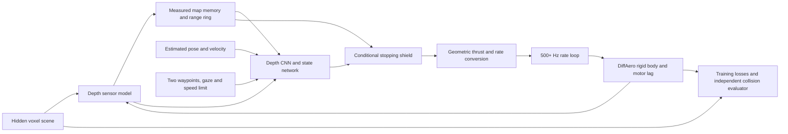

# Flight-policy training and evaluation

Phase 4 uses a different physics model from the Phase 3 point mass. Its policy
interface is depth plus estimated state, two world-frame waypoints, a gaze
target and a speed limit. Output is collective thrust in newtons and desired
body angular rates in radians/second. The learned component is a depth/state
acceleration residual over a nominal geometric controller. Both learners use
the same network, controller, initial seed and observation interface.



The policy does not receive occupancy, material labels, scene IDs, sampled
physical parameters, collision distances or scorer outputs. Simulator truth
is permitted for losses, rewards and independent evaluation. The ring stops at
unknown cells and is computed from map memory built using noisy measurements.
Invalid depth certifies no free space. Room labels are not flight-policy inputs.

The normal policy loop is 60 Hz, with rigid-body substeps no longer than 2 ms.
The shield probe checks at 100 Hz while holding the learned acceleration request
between 60 Hz updates. A body-rate loop runs inside the dynamics. It uses fixed
public nominal inertia, while the aircraft uses independently sampled inertia.
An earlier ideal episode-calibrated rate controller canceled inertia uncertainty;
the v2 adapter corrects this. Tests verify distinct low/high-inertia responses
and finite gradients. Rate gain, power model and braking capability still need
measurement on the actual aircraft.

CUDA dynamics can use `torch.compile(fullgraph=True)`; CPU uses eager PyTorch.
Compiled/eager state and action-gradient parity is tested. Initial compilation
and cache warmup are excluded from inference timing. Compilation changes
execution speed, not the prescribed simulator timestep.

## Episode randomization

All 29 v2 profile parameters (35 scalar dimensions) are sampled at every episode
reset. Integer image/edge fields, scalar ranges and each vector component use
independent deterministic seeds. Low/high endpoint modes are available. Sampling
and a parameter's actual model use are separate claims:

| Parameters | Runtime use |
| --- | --- |
| Mass, inertia, gravity, drag, maximum thrust, motor lag | Full rigid-body equations, authority bounds and first-order thrust actuator |
| Body radius | Exact continuous sphere/voxel collision checks and shield envelope |
| Battery energy | Approximate power consumption and authority decay, not an electrical battery model |
| Camera dimensions, horizontal/vertical FOV, minimum/maximum range | Exact pinhole voxel-DDA renderer |
| Depth base/quadratic noise, edge width/threshold, range dropout, material holes | Per-episode Phase 2 measurement noise model |
| Camera FPS | Measurement-age approximation; not an independently scheduled stereo camera |
| IMU acceleration/gyro noise and IMU rate | Noisy estimated velocity/body-rate approximation; not full inertial filtering |
| Optical-flow noise/rate and range noise | Estimated velocity/height error approximation; no full optical-flow fusion |
| Odometry drift per metre | Accumulated distance-dependent estimated-position error |
| Compute latency | Causal fractional action queue and depth delivery queue |

This makes the randomized training experiment reproducible. It does not establish
real-camera noise calibration, estimator accuracy or physical flight-controller
identification. Gaussian error models do not provide hard deterministic
estimation bounds for a safety proof.

## Training and task scope

Training cycles train apartments 100–109 at episode boundaries. Random task
starts are body-clear voxel centers; two connected straight legs turn, reverse
or change height within the furnished scene. Configuration-space checks use
the profile's maximum radius when creating routes. This provides two-waypoint
tracking tasks around clutter; it is not an exhaustive narrow-gap, arbitrary
acrobatics or exploration benchmark. Phase 4b skills are separate.

The initial state is level, stationary hover with thrust equilibrated to the
sampled weight. Initial command telemetry reflects this setup trim. These tasks
do not validate takeoff, hover-trim identification or recovery from an arbitrary
initial attitude.

Differentiable training minimizes velocity tracking, obstacle proximity,
normalized control changes, gaze alignment and speed-limit loss through the
full dynamics. The distance field is a conservative differentiable optimization
signal; actual collision termination uses independent exact swept-sphere checks.
Depth rendering and discrete map updates are detached; gradients still flow
through dynamics, state feedback and the network weights. See
`docs/flight_training.md` for the BPTT and PPO implementations.

The current trainer resets a whole vectorized batch if any drone terminates.
Other drones' PPO traces end at that boundary and bootstrap correctly, but this
reduces complete-trajectory experience. BPTT uses truncated rollout windows.
These are explicit training limitations, especially for later doorway turns.
More updates alone do not establish 99% reliability.

## Frozen evaluation

`phase4` trains both policies before generating any test task, writes exclusive
checkpoint files, reloads those weights, and checks identical evaluation cohort
digests. Checkpoints include profile/config/source hashes. Source changes during
training or checkpoint changes during evaluation invalidate the run. Test
results must not drive tuning on that same cohort.

Evaluation uses endpoint batches followed by independent interior samples, with
the same route/profile/noise seeds for both methods. Positive clearance values
outside the local exact-query cap are explicitly lower bounds. Success times
exclude failures, which remain in the success-rate denominator. Peak speeds,
speed-limit exceedances, collisions and shield interventions are retained per run.
A finite sample across the range is not an exhaustive proof over all combinations.

The shield has adversarial and bounded-trajectory tests. Its certificate is
conditional on valid map, estimation, latency, acceleration and braking bounds.
The current coupled quadrotor probe passes `assumptions_valid=False`, so it
actively brakes and never reports a certified command. Geometric unit tests
cannot establish the aircraft's tracking bounds. See `docs/safety_shield.md`.

Desktop inference measures one preprocessed observation after warmup. It includes
the network and geometric action conversion, with GPU synchronization when used;
it excludes the estimator, sensor, shield, scheduling and transport. The onboard
5 ms gate remains pending until measured on that computer.

## Commands and artifacts

```sh
make phase4-smoke
make phase4
.venv/bin/python -m ares evaluate-flight CHECKPOINT.pt --device cuda --split validation --episodes 100 --output reports/flight_validation.json
```

The main report separates software preparation, waypoint reliability, shield
validation and onboard timing. `--require-complete` fails until every gate is
met. `--smoke` checks integration without certifying reliability. Each invocation
uses a fresh run directory, preserving previous checkpoints. Evaluation-only
loading uses `weights_only=True` and validates frozen runtime sources.

The `flight` extra is optional. Default foundation/world/sensor/exploration
checks remain usable without Torch. The separate CPU-flight CI job and optional
`make phase4-container` include flight training tests and the bounded smoke.
`LICENSES.yaml` records the BSD vendored source and dependencies; unresolved
third-party binary redistribution questions are marked `commercial_ok: false`.
